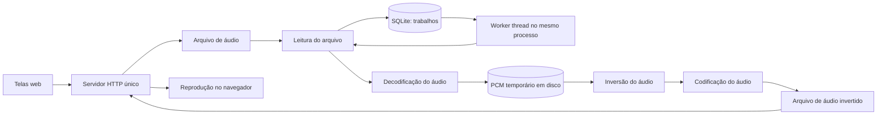

# Reprodução de áudio invertido Design

**Spec**: `.specs/features/audio-invertido/spec.md`
**Approved**: 2026-11-25 - user: "o desenho está aprovado"
**Status**: Aprovado para tarefas
**Approach chosen**: 2026-11-25 - user: "Node.js 24 + SQLite integrado (recomendado)"

## Architecture Overview

Uma aplicação Node.js 24 serve a página e recebe uploads. Uma `worker_thread` do mesmo processo executa um trabalho de áudio por vez, mantendo o servidor responsivo durante a inversão dos blocos. O SQLite integrado persiste os estados na thread principal. FFmpeg decodifica o MP3 em fluxo para PCM intercalado `f32le` em arquivo temporário no disco. O módulo de inversão lê esse PCM do fim para o começo em blocos alinhados a quadros de canais, com no máximo 16 MiB por bloco. Os blocos invertidos formam um único fluxo contínuo para um segundo processo FFmpeg, que codifica um único MP3 com LAME VBR qualidade 0. O arquivo gerado é publicado de forma atômica ao final. A lista pública e os downloads usam o mesmo servidor.



O navegador mostra a tela de envio com a lista pública. Após o upload completo e a inspeção inicial do MP3, o servidor cria o trabalho e responde com seu identificador. A tela de processamento consulta o estado periodicamente. Fechar a página não cancela o trabalho. Quando o estado muda para `concluído`, o navegador mostra a tela de resultado; nela o player usa o mesmo MP3 invertido que o link de download. A lista permite retomar trabalhos em outra sessão.

### Approach comparison

| Approach | Advantages | Costs | Decision |
| --- | --- | --- | --- |
| Node.js 24, HTTP e SQLite integrados, FFmpeg | Um processo e um projeto; streams com backpressure; poucas dependências de aplicação. | `node:sqlite` é release candidate no Node 24; operações SQLite são síncronas. | Escolhido pelo usuário. |
| Python 3.14, aiohttp, SQLite e FFmpeg | SQLite da biblioteca padrão; aiohttp documenta upload em blocos e tarefas em segundo plano. | Mais uma dependência de servidor e mais coordenação entre I/O de arquivo e loop assíncrono. | Alternativa considerada. |

O filtro `areverse` do FFmpeg não entra no desenho: sua documentação informa que ele guarda o clipe inteiro em memória. O arquivo PCM temporário torna a inversão aleatória possível sem esse crescimento de memória.

## Code Reuse Analysis

O repositório só contém README e skills. Não há aplicação, testes ou padrões de código a reutilizar. O projeto usará módulos nativos do Node.js 24 (`node:http`, `node:stream`, `node:fs`, `node:child_process`, `node:worker_threads`, `node:sqlite`, `node:test`) e os executáveis FFmpeg/ffprobe. A interface será HTML, CSS e JavaScript servidos pelo mesmo processo, sem aplicação separada nem etapa de build frontend.

## Components and Interfaces

| Box / component | Location | Public internal interface | Dependencies |
| --- | --- | --- | --- |
| Arquivo de áudio | `src/modules/audio-input.mjs` | `receiveOriginal(request, jobId, displayName, dataDir)` grava o corpo HTTP por stream em `original.part`; `commitOriginal(jobId)` publica o MP3 aceito. | `node:stream/promises`, `node:fs` |
| Leitura do arquivo | `src/modules/file-reader.mjs` | `probeMp3(path)` retorna `sampleRate`, `channels` e codec; rejeita entrada sem stream MP3 reconhecível. | `ffprobe` via `spawn`, JSON limitado |
| Decodificação do áudio | `src/modules/audio-decoder.mjs` | `decodeToPcm(inputPath, pcmPath, meta)` grava PCM `f32le` intercalado e retorna contagem de quadros. | `ffmpeg` via `spawn`, módulo de leitura |
| Inversão do áudio | `src/modules/audio-reverser.mjs` | `reversedChunks(pcmPath, channels, maxChunkBytes)` produz blocos PCM invertidos por quadro, do fim ao início. | Leitura por posição em `node:fs/promises` |
| Codificação do áudio | `src/modules/audio-encoder.mjs` | `encodeMp3(chunks, meta, tempOutputPath)` consome blocos com backpressure e verifica o encerramento do FFmpeg. | `ffmpeg`, `libmp3lame` |
| Arquivo de áudio invertido | `src/modules/reversed-file.mjs` | `publish(tempOutputPath, finalPath)` valida e renomeia; `serveReversed(response, job, disposition)` entrega MP3 com suporte a `Range`. | `node:fs`, módulo de leitura |
| Reprodução | `public/modules/playback.mjs` | `mountPlayer(container, url)` cria e controla o elemento nativo `<audio controls>` para o MP3 invertido. | API de mídia do navegador |
| Estado dos trabalhos | `src/job-store.mjs` | `create`, `get`, `listPage`, `transition`, `requeueInterrupted`. | `node:sqlite` |
| Orquestração | `src/job-runner.mjs`, `src/job-worker.mjs` | `start`, `runNext`, `stop`; inicia uma worker thread por trabalho e recebe mensagens de fase, conclusão ou falha. | `node:worker_threads`, sete módulos, estado dos trabalhos |
| HTTP e telas | `src/http-server.mjs`, `public/app.mjs`, `public/index.html`, `public/styles.css` | Rotas de upload, lista, estado e download; navegação entre três telas. | Módulos acima |

Os sete módulos das caixas terão testes próprios e contratos exportados. O orquestrador conhece a sequência; nenhum módulo de áudio importa o módulo de interface. A thread principal é a única que altera o SQLite; a worker thread troca mensagens curtas de estado com ela. O módulo de reprodução fica no navegador, mas integra o mesmo projeto e recebe o arquivo publicado pelo módulo de saída.

## Audio Processing Contract

1. O upload é enviado como corpo MP3 bruto. O navegador manda o nome codificado em `X-File-Name`; o servidor o decodifica e sanitiza. `stream.pipeline` grava no disco com backpressure. O nome é usado apenas como texto exibido e no cabeçalho de download. Nenhum byte do nome compõe caminhos de arquivo.
2. `ffprobe` confirma `codec_name=mp3`, taxa de amostragem e um ou dois canais. A extensão e o tipo MIME não são usados como prova do formato. A corrupção posterior à inspeção inicial torna o trabalho `falhou`.
3. FFmpeg decodifica uma vez para `f32le` no disco. O tamanho do PCM deve ser múltiplo de `4 × channels`; caso contrário o trabalho falha. A contagem de quadros é `pcmBytes / (4 × channels)`.
4. A inversão escolhe `chunkBytes = floor(16 MiB / frameBytes) × frameBytes`. Para cada trecho, lê por posição a partir do fim do PCM e troca a ordem dos quadros completos no bloco. Os bytes de canais dentro de cada quadro permanecem na mesma ordem. Se o PCM original contém blocos `A, B, C`, a saída é `reverseFrames(C), reverseFrames(B), reverseFrames(A)`. O bloco é entregue ao codificador apenas quando o bloco anterior foi consumido. Tamanhos e posições de arquivo usam `bigint` nas APIs de leitura.
5. Os blocos são juntados como fluxo PCM contínuo na entrada padrão de um único processo FFmpeg, com taxa e canais explícitos. Ele gera um único `output.part.mp3` com `libmp3lame` em VBR qualidade 0. Não são criados MP3 separados por bloco. O processo só termina com sucesso após saída zero e arquivo MP3 sondável.
6. O módulo de saída renomeia `output.part.mp3` para `output.mp3` no mesmo volume e marca o trabalho `concluído` no SQLite. O PCM temporário é removido; original e saída final não são removidos automaticamente.

O processamento não usa `readFile` para áudio nem o filtro `areverse`. Cada processo filho recebe caminhos gerados pelo servidor em argumentos de `spawn`, sem shell. Saída de diagnóstico dos processos é limitada em memória e associada ao ID do trabalho nos logs. A inversão de quadros acontece na worker thread; a thread HTTP continua atendendo consultas e downloads.

Essa montagem equivale a juntar os blocos ao final, mas mantém uma só sessão de codificação MP3. Assim, o codificador não reinicia a cada bloco e o resultado é publicado como um único arquivo apenas após a última verificação.

## Data Models and State

```text
jobs(
  id TEXT PRIMARY KEY,              -- UUID gerado pelo servidor
  original_name TEXT NOT NULL,       -- nome sanitizado para exibição
  status TEXT NOT NULL,              -- queued | processing | completed | failed
  phase TEXT,                        -- reading | decoding | reversing | encoding | publishing
  error_code TEXT,
  sample_rate INTEGER,
  channels INTEGER,
  original_bytes INTEGER,
  output_bytes INTEGER,
  created_at INTEGER NOT NULL,
  updated_at INTEGER NOT NULL
)
```

Os caminhos são derivados de `DATA_DIR/jobs/<id>/`, nunca recebidos do navegador: `original.mp3`, `scratch.pcm`, `output.part.mp3` e `output.mp3`. `DATA_DIR` fica fora do repositório e precisa ser um volume persistente no ambiente de execução. O espaço temporário para PCM é `duração_em_segundos × taxa_de_amostragem × canais × 4` bytes; uma hora estéreo a 44,1 kHz ocupa cerca de 1,18 GiB. Uma página da lista consulta no máximo 20 trabalhos, ordenados por `created_at DESC, id DESC`, com cursor para alcançar trabalhos antigos sem carregar a tabela inteira.

Transições válidas: `queued → processing → completed|failed`. Na inicialização, o orquestrador examina trabalhos `processing`: se `output.mp3` final está íntegro, conclui o registro; senão remove apenas artefatos parciais, recoloca o trabalho na fila e reprocessa o original. Uma worker thread que termina com erro durante a execução marca o trabalho `failed`. Um trabalho aceito mantém `original.mp3` mesmo em falha. Uploads incompletos, que ainda não são trabalhos aceitos, são descartados. Duas submissões do mesmo arquivo criam IDs distintos.

## HTTP and UI Contract

| Route | Behavior |
| --- | --- |
| `GET /` | Serve a aplicação e a tela de envio com lista pública. |
| `POST /api/jobs` | Recebe corpo MP3 por stream, sonda formato e cria trabalho; devolve `201` com ID e `queued`. Entrada inválida devolve `415`. |
| `GET /api/jobs?cursor=...` | Lista pública paginada. |
| `GET /api/jobs/:id` | Estado e metadados de um trabalho. |
| `GET /api/jobs/:id/original` | Download do MP3 original aceito, inclusive em `failed`. |
| `GET /api/jobs/:id/reversed` | Entrega o MP3 invertido inline apenas em `completed`; responde a intervalos `Range` para busca no player. |
| `GET /api/jobs/:id/reversed/download` | Baixa o mesmo MP3 invertido com `Content-Disposition: attachment`. |

O navegador envia o objeto `File` sem convertê-lo em base64 nem lê-lo inteiro em JavaScript. Durante o upload, o controle de envio indica `Enviando`. Após receber o ID, navega para a tela de processamento com ícone animado e consulta o estado. Ao concluir, abre a tela de resultado com `<audio controls>` e os dois links. Ao falhar, mostra o motivo e o link do original. A lista pública permanece na tela inicial. O nome do arquivo é inserido com `textContent`, não HTML.

O servidor desativa o prazo total padrão de recebimento de requisição (`requestTimeout=0`) para permitir uploads lentos de qualquer duração. Um prazo de inatividade entre bytes pode encerrar uploads abandonados, sem limitar o tempo total de um envio ativo. Nenhum prazo é aplicado à worker thread ou ao FFmpeg. A aplicação executa um trabalho de áudio por vez e mantém os demais na fila, para limitar pressão de CPU, RAM e disco.

## Error Handling Strategy

| Scenario | Handling | User impact |
| --- | --- | --- |
| Corpo não é MP3 reconhecível | Apaga `original.part`; não cria registro. | Mensagem `Arquivo MP3 inválido ou não suportado`. |
| Upload interrompido | Fecha stream e apaga arquivo parcial. | Nenhum trabalho aparece na lista; pode reenviar. |
| MP3 corrompido durante decodificação | Marca `failed`, mantém original e apaga PCM/saída parciais. | Tela de falha com original disponível. |
| FFmpeg ausente ou sem `libmp3lame` | Falha na verificação de inicialização com mensagem operacional. | Serviço não anuncia processamento indisponível como sucesso. |
| Falta de espaço | Marca trabalho aceito como `failed`, mantém original quando já persistido; remove apenas parciais. | Motivo `Sem espaço de armazenamento`. |
| Reinício durante processamento | Reconcilia estado, reusa saída final íntegra ou recomeça do original. | Trabalho continua consultável na lista. |
| Worker thread termina inesperadamente | Marca trabalho `failed`, mantém original e elimina temporários. | Tela de falha com original disponível. |

## Risks & Concerns

| Concern | Location | Impact | Mitigation |
| --- | --- | --- | --- |
| Acesso sem login e retenção sem expiração expõem originais e saídas a qualquer visitante e fazem o uso de disco crescer continuamente. | Requisito aprovado | Privacidade e esgotamento de armazenamento. | A interface deixa o caráter público explícito; armazenamento persistente monitorado; falha de falta de espaço é visível. Nenhuma exclusão automática será introduzida. |
| PCM temporário pode ser muito maior que o MP3 de entrada. | `audio-decoder` / `DATA_DIR` | Um trabalho pode falhar por espaço mesmo que o upload caiba. | Gravar no mesmo volume monitorado, remover temporários após conclusão/falha e publicar saída só depois de validá-la. |
| `node:sqlite` em Node 24 é release candidate e usa chamadas síncronas. | `job-store.mjs` | Mudança futura de API ou pausas do loop por consultas grandes. | Fixar Node 24.22+, isolar acesso em um módulo, usar consultas paginadas e transações curtas. |
| O servidor Node tem prazo padrão de cinco minutos para receber a requisição. | `http-server.mjs` | Upload grande pode ser interrompido. | Definir `requestTimeout=0` e testar envio lento; manter limite de inatividade para conexão parada. |
| Um proxy ou hospedagem pode impor limite de corpo ou tempo total mesmo quando a aplicação não impõe. | Implantação futura | Upload grande falha antes de chegar ao Node. | Verificar configuração do ambiente escolhido antes de publicar; documentar a exigência de upload por stream sem limite total. |
| FFmpeg/ffprobe não estão instalados neste ambiente. | Ambiente local | Integração de áudio ainda não pode ser executada. | Documentar instalação e verificar binários e codificador no início da implementação; testes de integração exigem ambos. |
| MP3 é um formato com perdas e pode acrescentar atraso/preenchimento. | Codificação | A saída não é cópia PCM exata e a duração pode variar. | VBR 0, uma única recodificação, teste de ordem temporal e tolerância de um quadro do spec. |
| Inverter milhões de quadros em JavaScript pode bloquear o loop HTTP. | `audio-reverser` | Lista e downloads ficam lentos durante blocos grandes. | Executar o fluxo de áudio em uma `worker_thread` do mesmo processo; SQLite permanece na thread principal. |

## Tech Decisions

| Decision | Choice | Rationale |
| --- | --- | --- |
| Aplicação e persistência | Node.js 24 com HTTP e `node:sqlite` integrados; ver `AD-001`. | Uma implantação e poucos componentes externos. |
| Conversão e inversão | FFmpeg → PCM `f32le` temporário → leitura reversa por quadros → FFmpeg/LAME. | Inversão real com memória limitada, mesmo para arquivos grandes. |
| Trabalho em segundo plano | Uma worker thread por trabalho, execução sequencial, fila em SQLite e recuperação na inicialização. | Não depende da página aberta, preserva a resposta do servidor e dispensa serviço separado. |
| Publicação | Arquivo parcial no mesmo volume, validação e renomeação antes de marcar `completed`. | Evita link para saída incompleta. |
| Acompanhamento | Consulta periódica de estado pela página. | Simples, persistente após fechar e reabrir o navegador. |

## Verification Plan

- Testar o módulo de inversão com PCM mono e estéreo contendo marcadores em cada quadro. Um caso terá mais de 16 MiB e marcador exatamente na fronteira entre blocos. A concatenação dos blocos produzidos deve ser igual à reversão de referência quadro a quadro, sem trocar os canais.
- Medir o maior bloco criado pelo módulo de inversão e verificar que ele não supera 16 MiB para entradas de tamanhos diferentes.
- Gerar MP3 de referência com sinais distintos no início e no fim, executar a cadeia completa, decodificar a saída e verificar a ordem dos sinais, a taxa, os canais e a tolerância de duração do spec.
- Exercitar upload interrompido, MP3 inválido, falha do codificador, reinício durante trabalho e download `Range` usado pelo player.

## Documentation consulted

- [Node.js 24 SQLite](https://nodejs.org/docs/latest-v24.x/api/sqlite.html): `DatabaseSync` e estágio release candidate.
- [Node.js streams](https://nodejs.org/api/stream.html): backpressure e `pipeline`.
- [Node.js 24 HTTP](https://nodejs.org/download/release/latest-v24.x/docs/api/http.html): prazo padrão de recebimento de requisição.
- [Node.js 24 fs](https://nodejs.org/download/release/v24.22.2/docs/api/fs.html): leitura por posição, inclusive `bigint`.
- [Node.js 24 worker threads](https://nodejs.org/download/release/v24.22.2/docs/api/worker_threads.html): execução paralela de código JavaScript intensivo em CPU.
- [FFmpeg filters](https://ffmpeg.org/ffmpeg-filters.html): `areverse` requer memória para o clipe inteiro.
- [FFmpeg formats](https://ffmpeg.org/ffmpeg-formats.html): PCM `f32le` bruto não leva metadados.
- [FFprobe](https://ffmpeg.org/ffprobe.html): seleção de stream e saída JSON.
- [FFmpeg codecs](https://www.ffmpeg.org/ffmpeg-codecs.html): codificação `libmp3lame`.
